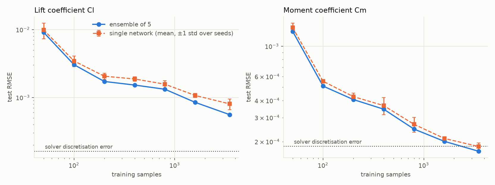
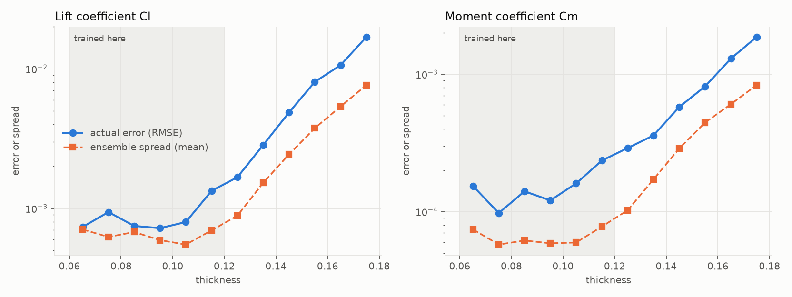
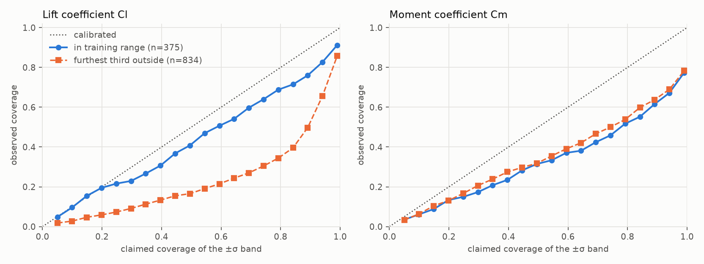
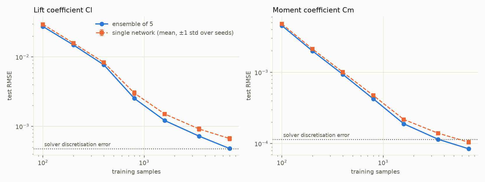
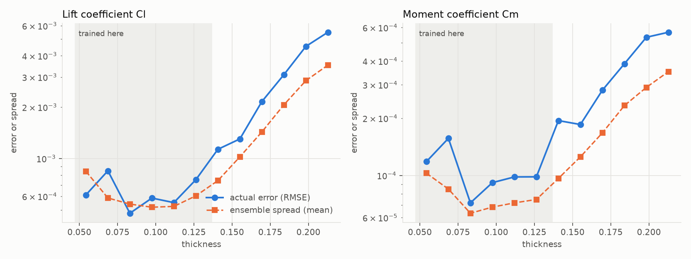

# FoilNet

[](https://github.com/AlexF0643/FoilNet/actions/workflows/ci.yml)

A neural-network surrogate for aerofoil aerodynamics, trained on data from a panel-method solver I wrote myself.

Aerodynamic solvers are accurate but slow, and design work means running them thousands of times. A surrogate is a network trained to copy the solver: give it an aerofoil shape and an angle of attack and it returns lift and moment coefficients in microseconds.

Getting a network that fits isn't the interesting part. What I want to find out is:

- How much training data does the network actually need?
- Where does it stay trustworthy, and where does it fail quietly?
- Can it tell me when it's guessing?

I write and validate the solver myself, so I understand the physics behind every label instead of treating the dataset as a black box.

## Status

**Phases 0 to 8 done (spine, geometry, panel solver, dataset, NumPy network, PyTorch surrogate, uncertainty and honest testing, CST shapes, interactive viewer).** A single network reproduces the solver's Cl and Cm to about 0.1% and 0.3% of their spread on held-out NACA shapes, and an ensemble does about as well on the nine-input CST shapes with more data and training. The ensemble spread flags extrapolation, but how honest it is varies (see the two results sections). The viewer is the last piece before release polish.

## Install

Needs Python 3.11 or newer.

```bash
git clone https://github.com/AlexF0643/FoilNet.git
cd FoilNet
python -m pip install -e ".[dev]"
pytest
```

The PyTorch and plotting dependencies are optional extras (`.[ml]`, `.[plots]`) and aren't needed until the later phases.

## Usage

```bash
foilnet solve 2412 --alpha 4
```

```
NACA 2412  alpha = 4 deg  panels = 160
Cl      = 0.7415
Cm(c/4) = -0.0612
```

From Python:

```python
from foilnet.geometry import naca4_from_code
from foilnet.solver import PanelSolver

solver = PanelSolver(naca4_from_code("2412", n_panels=160))
print(solver.solve(4.0).cl, solver.solve(8.0).cl)  # new angles of attack are almost free
```

`foilnet serve` starts the interactive viewer (see below).

## Dataset

```bash
foilnet generate --config configs/dataset-naca4.toml
```

This draws 5000 Latin hypercube samples of (camber, camber position, thickness, angle of attack), runs the panel solver on each in parallel, and writes `data/naca4-lhs.npz` (about 25 s on 8 cores). Every file carries its provenance: solver id and foilnet version, panel count, seed, parameter ranges, library versions and creation time. The same seed gives the same shapes whatever the number of workers, and the labels agree to rounding error (about 1e-14).

```python
from foilnet.data import load_dataset, random_split, Standardizer

ds = load_dataset("data/naca4-lhs.npz")
train, val, test = random_split(ds, (0.7, 0.15, 0.15), seed=0)
scaler = Standardizer.fit(train.x)  # fit on training data only
```

Labels are Cl and Cm from 160-panel solves. They are not noisy: each label is a deterministic function of the inputs, so a network can learn them exactly. They do differ slightly from a converged solver. On the test set, a 640-panel solve differs from the labels by an RMS of 1.6e-4 in Cl and 1.9e-4 in Cm (spreads are 0.62 and 0.054), and by up to 4e-4 and 8e-4 in a sample of rows, worst for thin, highly cambered sections at high angle of attack. A surrogate trained on these labels reproduces the 160-panel solver, so measured against a converged solver it carries that difference on top of its own error. Each sample also stores its pressure drag, which should be zero and is a per-sample check on numerical error.

## Surrogate

```bash
python -m pip install -e ".[ml]"   # PyTorch (CPU is fine)
foilnet generate
foilnet train
```

`foilnet train` splits the dataset 70/15/15, trains the PyTorch network from `configs/train-mlp.toml`, restores the epoch with the lowest validation loss, saves `runs/mlp.pt`, and prints errors on the validation and test sets (about a minute). The test set is used only for that final report.

```python
from foilnet.nn.train import Surrogate

model = Surrogate.load("runs/mlp.pt")
model.predict([[0.02, 0.4, 0.12, 4.0]])  # camber, camber position, thickness, alpha (deg) -> Cl, Cm
```

Result on 750 held-out shapes (one run, seed 0):

| | RMSE | max error | share of label spread |
|---|---|---|---|
| Cl | 7.0e-4 | 4.6e-3 | 0.11% |
| Cm | 1.65e-4 | 1.25e-3 | 0.31% |

The chosen settings, and how far to trust each, are in [docs/hyperparameters.md](docs/hyperparameters.md). The short version: learning rate, schedule and epochs matter; the differences between reasonable network sizes are inside seed-to-seed noise (about 30%). Cm error (1.65e-4) is about the size of the labels' distance from a converged solver (1.9e-4); the Cl error is about 4x that.

This is accuracy on shapes drawn from the same ranges as the training data. How it behaves outside them, and whether it can tell, is the next section.

## Uncertainty and honest testing

`foilnet train --members 5` trains a deep ensemble (after Lakshminarayanan et al., 2017): five networks that differ only in their random start. The prediction is their mean and the uncertainty is the spread between them. Full tables and the code that produced them are in [docs/results.md](docs/results.md); `python -m foilnet.analysis.experiments` regenerates them in about ten minutes. Everything below is one seeded run (one data split, five members), so treat differences of tens of percent with caution.

```python
from foilnet.nn.ensemble import Ensemble

ensemble = Ensemble.load("runs/ensemble.pt")
mean, spread = ensemble.predict([[0.02, 0.4, 0.12, 4.0]])  # Cl and Cm, and their uncertainty
```

**The ensemble is more accurate than one network.** On the 750 test shapes its RMSE is 5.3e-4 in Cl (a single network averages 7.8e-4) and 1.68e-4 in Cm (1.81e-4).

### How much data does it need?



| training samples | Cl RMSE | share of Cl spread | Cm RMSE | share of Cm spread |
|---|---|---|---|---|
| 50 | 9.1e-3 | 1.5% | 1.3e-3 | 2.4% |
| 100 | 3.0e-3 | 0.49% | 5.1e-4 | 0.96% |
| 200 | 1.7e-3 | 0.28% | 4.1e-4 | 0.77% |
| 400 | 1.5e-3 | 0.24% | 3.5e-4 | 0.65% |
| 800 | 1.3e-3 | 0.21% | 2.5e-4 | 0.47% |
| 1600 | 8.5e-4 | 0.14% | 2.0e-4 | 0.38% |
| 3500 | 5.6e-4 | 0.09% | 1.7e-4 | 0.32% |

It depends on how accurate you need it. About 100 samples gets the error under 0.5% of the spread in Cl, 400 gets it under 0.25%, and 3500 gets it under 0.1%. Cl error falls roughly as the square root of the number of samples (about n^-0.5 from 100 to 3500) and is still falling at 3500, so more data would help. Cm flattens out near 1.7e-4, close to the dotted line, which is the labels' distance from a converged solver. Whether that is a limit of the data, the network, or the labels, I have not determined. Small training sets also vary a lot from seed to seed (a single network at 50 samples varies by about 25%). To keep small sets from being under-trained, every run gets at least 4000 optimiser steps, which means more epochs.

### Where does it fail?

I trained on thickness below 12% only (1750 samples) and tested on the rest of the range, in three bands out to 18%, which is 1.5 times the thickest training shape.



| band | Cl RMSE | Cl ensemble spread | error / spread | Cm RMSE | Cm ensemble spread | error / spread |
|---|---|---|---|---|---|---|
| in range (held out) | 9.1e-4 | 6.4e-4 | 1.5 | 1.6e-4 | 6.5e-5 | 3.2 |
| thickness 0.12 to 0.14 | 2.3e-3 | 1.2e-3 | 1.8 | 3.3e-4 | 1.4e-4 | 3.0 |
| thickness 0.14 to 0.16 | 6.6e-3 | 3.1e-3 | 2.0 | 7.1e-4 | 3.7e-4 | 2.4 |
| thickness 0.16 to 0.18 | 1.4e-2 | 6.5e-3 | 2.1 | 1.6e-3 | 7.2e-4 | 3.7 |

The failure is graceful but steep. Error grows about 2 to 3 times with each band, so at the far end Cl is 15 times worse than in range (and Cm 10 times), with a worst single error of 0.052 in Cl. That is still only about 2% of the Cl spread, because Cl depends smoothly on thickness. A network can extrapolate a smooth trend for a while, which is not the same as being right, and the error would not stay this small for a less smooth quantity.

### Can it tell when it is guessing?

Partly. The spread is a useful warning light but not a calibrated error bar.

- **It notices.** The mean Cl spread grows about 10 times across the bands (6.4e-4 to 6.5e-3), and within the bands outside the training range it ranks the worse samples well (Spearman correlation 0.5 to 0.6 for Cl). Inside the training range it is a poor guide to which individual samples are worst (0.1 to 0.2).
- **It understates the size.** The real error is about 1.2 to 1.5 times the spread for Cl inside the training range and about 2 times outside it, and 2.4 to 3.7 times for Cm everywhere. A band of plus or minus one spread should hold 68% of errors. For Cl it holds 73% on the full-range ensemble (so Cl is roughly calibrated in range), but 28% and 26% in the two furthest bands. For Cm it holds only 48% even in range.



**Why.** Each member's error has a part that is private to that member (a bad start) and a part shared by all members (what this network and data cannot capture). The spread can only see the first part. A rough split, assuming the shared part is the same for every member and the private part is independent: for Cl about 30% of a single network's squared error is shared; for Cm about 80% is. That matches what we see. Cm's measured spread (7.0e-5) understates its error badly, while the spread implied by the split (7.7e-5) agrees with it, and the same check for Cl gives 6.5e-4 implied against 5.8e-4 measured, so the split hangs together. Averaging more members cannot reduce the shared part, which is why Cm barely improves with an ensemble. For Cl, multiplying the spread by about 2 would roughly fix the calibration outside the training range (about 1.5 inside). I have not applied or tested that on separate data, and the factor would have to be fitted on held-out samples.

### Speed

On this machine (CPU only; timings varied by about 2 times between runs, so read these as orders of magnitude):

| what is timed | time |
|---|---|
| solver, new shape each call | about 10 to 15 ms |
| solver, same shape, new angle of attack | about 0.05 to 0.2 ms |
| ensemble, large batch, per sample | about 6 to 7 microseconds |
| ensemble, one sample per call | about 2 ms |

In a large batch the ensemble is about 1,500 to 2,200 times faster than solving a new shape. Called one sample at a time it is only about 4 to 6 times faster, because five networks each cost a PyTorch call (a single network is about 30 times faster). And for a sweep of angles on one fixed shape the solver is already fast, since it reuses its factorised matrix. The surrogate's real advantage is bulk evaluation over many different shapes.

## From-scratch network

`foilnet.nn.numpy_mlp` is a multi-layer perceptron in plain NumPy with backprop derived by hand (the derivation is in the module docstring) and an Adam optimiser. It is a learning exercise and a cross-check, not the final surrogate: PyTorch takes over in Phase 5.

Backprop is checked against finite differences (`gradient_check`), which agree to about 1e-10 for tanh and ReLU, with and without weight decay.

A first fit on the Phase 3 dataset, as a sanity check only (one seed, one split, a 4-64-64-2 tanh network, 300 epochs, hyperparameters not tuned), validation RMSE on 750 held-out samples:

| training samples | Cl RMSE | Cm RMSE |
|---|---|---|
| 100 | 0.021 | 0.0021 |
| 400 | 0.0067 | 0.00075 |
| 1600 | 0.0035 | 0.00032 |
| 3500 | 0.0032 | 0.00029 |

For scale, the labels have a spread of 0.63 in Cl and 0.054 in Cm, so 3500 samples gets within about 0.5% of the spread. This is not yet a proper learning curve; that comes with the PyTorch surrogate in Phase 6.

## CST shapes: a richer design space

NACA 4-digit sections have three shape settings. CST (Kulfan) shapes describe each surface as a smooth sum of four coefficients, so one aerofoil is eight shape numbers plus the angle of attack: nine inputs, and shapes a NACA code cannot express. The geometry is in `foilnet.geometry.cst`, the sampling box and limits in `configs/dataset-cst.toml`.

```bash
foilnet generate --config configs/dataset-cst.toml    # 10,000 shapes at 320 panels, about 3 minutes on 8 cores
foilnet train --members 5 --config configs/train-mlp-cst.toml --data data/cst-lhs.npz --out runs/ensemble-cst.pt
python -m foilnet.analysis.experiments --data data/cst-lhs.npz --config configs/train-mlp-cst.toml \
    --out docs/results-cst.md --figures docs/assets/cst --ensemble-out runs/ensemble-cst.pt \
    --sizes 100,200,400,800,1600,3500,7000 --label-check-samples 500    # about 20 minutes
```

### What random CST shapes taught me about the solver

Random coefficients make shapes the panel solver cannot answer, and the solver is not equally accurate on the rest. The full evidence is in [docs/cst-validity.md](docs/cst-validity.md); in short:

- **A knife-edge nose has no valid answer.** When the lower surface leaves the nose flat, potential flow has infinite suction there. In my first 10,000 samples 17% had a failed solve, and refining the panels made it worse, not better (surface Cp of -1.4e5 at 80 panels, -3.9e8 at 1280). Those shapes are now rejected by a nose-radius rule.
- **A drooping trailing edge converges more slowly.** At 160 panels the CST labels differed from a 640-panel solve by an RMS of 1.5e-3 in Cl, ten times the NACA labels' 1.6e-4. The error tracks how steeply the upper surface runs into the trailing edge. The CST labels therefore use 320 panels, which cuts the error about threefold. This is a weakness of my solver, which I have not fixed.
- **Small trailing-edge angles are fine.** I had expected near-cusped edges to be the problem. Against the exact solution, the Cl error is about 1e-3 at 1.8 degrees and only a true cusp (zero angle) is bad, so the limit is 5 degrees.
- Roughly 41% of candidate shapes pass; the generator keeps drawing until it has enough.

### Does the network still cope?

Yes, with a longer training budget. A validation-set search (see [docs/hyperparameters.md](docs/hyperparameters.md)) picked a 256 x 256 network trained for 800 epochs; for the NACA data 800 epochs had added almost nothing, but here the loss was still falling. On 1,500 held-out shapes the five-network ensemble reaches an RMSE of 4.8e-4 in Cl and 8.3e-5 in Cm (0.08% and 0.13% of the label spread), against 5.2e-4 and 1.7e-4 for the NACA ensemble. That comparison is not like for like, since the CST ensemble trained on 7,000 samples and the NACA one on 3,500. Using the NACA settings (128 x 128, 400 epochs) on the CST data gives 8.4e-4 and 1.2e-4. Full tables: [docs/results-cst.md](docs/results-cst.md).

### How much more data does it need?



Ensemble test RMSE in Cl, with the NACA numbers from above for comparison:

| training samples | CST (9 inputs) | NACA (4 inputs) | ratio |
|---|---|---|---|
| 100 | 2.7e-2 | 3.0e-3 | 9 |
| 200 | 1.5e-2 | 1.7e-3 | 9 |
| 400 | 7.7e-3 | 1.5e-3 | 5 |
| 800 | 2.5e-3 | 1.3e-3 | 1.9 |
| 1600 | 1.2e-3 | 8.5e-4 | 1.4 |
| 3500 | 7.2e-4 | 5.6e-4 | 1.3 |
| 7000 | 4.8e-4 | not run | |

For the same accuracy the CST problem needs several times more data: about 800 samples to get Cl error under 0.5% of the spread (NACA: 100), 1,600 for 0.25% (NACA: 400), and 7,000 for 0.1% (NACA: 3,500). The gap narrows with more data, and the CST error is still falling at 7,000 (roughly as n^-0.6 over the last doubling). For Cm the CST curve drops below the NACA one from about 1,600 samples on (1.15e-4 against 1.7e-4 at 3,500 samples). I have not tested why; one possibility is that NACA's camber line has a kink at the position of maximum camber and the CST surfaces are smooth, but that is a guess.

### Extrapolation and uncertainty



I repeated the thin-to-thick test: train on shapes thinner than 13.7% (the median) and test on thicker ones, out to 22%. The Cl error grows 7.5 times from in range (6.5e-4) to the far band (4.9e-3), a much gentler rise than for NACA (15 times). The ensemble spread tracks it closely this time: error is 1.15 times the spread in range and 1.3, 1.4 and 1.5 times in the three bands outside, and the plus-or-minus-one-spread band holds 69% of errors in range and 59% in the farthest band (68% if calibrated). For NACA the spread understated the error by about 2 times or more.

Two cautions. First, this is not the same experiment as for NACA. Thickness is not an input here: a thick CST shape is built from coefficient values that thinner training shapes also contain, so it is a milder kind of extrapolation. I have not tested extrapolating a coefficient beyond its sampled range. Second, how honest the spread is depends on how long the networks were trained. With the NACA settings, the CST ensemble's error was 1.0 times its spread in Cl and 1.2 times in Cm (the one-spread band held 76% and 72%); with the longer-trained settings it was 1.5 and 1.8 times (71% and 59%). Longer training made the members agree with each other faster than it made them accurate. This is one comparison on one split, not a rule.

## The viewer

```bash
foilnet serve --model runs/ensemble.pt          # NACA shapes
foilnet serve --model runs/ensemble-cst.pt      # CST shapes
```

This starts a small web server on `127.0.0.1` (this computer only) and prints the address; add `--open` to open it in your browser, `--port` to change the port. It needs a model from `foilnet train --members N` (or a single network from `foilnet train`) and nothing else: the shape family, the trained ranges and the panel count are read from the model file. The page is one HTML file with no external scripts, and the server uses only the standard library.

What it shows, as you move the sliders:

- **The aerofoil**, with the free-stream direction for the current angle, and an optional dot at each panel node.
- **Solver and network side by side**: Cl and Cm from the panel solver, the network's mean with the spread between its members, and the difference.
- **Sweep mode**: Cl (or Cm) against angle of attack for the current shape, drawn by the solver (blue) and the network (orange, with a band of plus or minus one spread). The curve redraws as you move the shape sliders. The sweep runs 6 degrees beyond the trained angles on each side, and the trained angles are shaded, so you can see what happens outside them.
- **Pressure distribution** from the solver (the network predicts Cl and Cm only). On some shapes (about 6% of random NACA sections, more CST ones, mostly cambered sections at high angle) the solver puts a spurious suction spike on the single panel at the trailing edge, down to Cp of -23. It does not shrink with more panels, while Cl and Cm do converge and barely depend on that panel (it is tiny), so the plot leaves it out, says so, and the table keeps it. It is a weakness of the solver's trailing-edge treatment that I have not fixed.
- **Checks**: any slider outside the range the network was trained on is named, with a warning that the network is extrapolating, and for CST shapes any breach of the shape limits is listed. Sliders reach 25% past the trained range on each side, with the trained part shaded on the slider, so extrapolating is one drag away.

Things worth trying: drag a CST coefficient past its shaded range and watch the gap between the two curves open while the band stays narrow (that is the spread understating the error, measured in the results sections above); or sweep past the trained angles with a typical shape: in the CST model the two curves stay together to the end of the sweep, because lift is nearly linear in angle, so extrapolating in angle is much easier than extrapolating in shape. The solver is inviscid, so no setting produces stall, however high the angle.

The same calculation is available without the page: `foilnet.viewer.ViewerModel(model).evaluate({...})` returns the numbers the page draws.

## Solver validation

The solver is a linear-vortex panel method with a Kutta condition. Nothing downstream is trusted until it passes these, and each one is a test in `tests/`:

- **Exact solution.** Against the Karman-Trefftz aerofoil (conformal map of flow past a circle; Joukowski is the `n = 2` case), at 160 panels, over several shapes and angles from -4 to 10 degrees: Cl agrees to within 0.1%, and Cp to within 0.02 + 2% of the local value away from the trailing edge. The exact solution is itself checked first: integrating its Cp reproduces its Kutta-Joukowski lift to 1e-5 and gives zero drag.
- **Thin-aerofoil theory.** Lift slope follows 2 pi (1 + 0.77 t/c) to 1.5% for 6, 12 and 18% thick sections. For thin cambered sections the zero-lift angle is within 0.1 degrees and Cm within 0.005 of theory.
- **Convergence.** Cl and Cm errors fall by more than 2x per doubling of panels (about 4x in practice, as expected for a second-order method). At 160 panels, Cl is within 0.1% of the 1280-panel result.
- **Consistency.** Pressure drag, which should be zero, is below 1e-3; lift from integrating Cp agrees with Kutta-Joukowski; the flow inside the body is near zero when checked by independent numerical quadrature.

Known weak spots, found while validating:

- **A true cusp is not handled; small angles are.** The pure Joukowski aerofoil (zero trailing-edge angle) gives about 2% Cl error at 160 panels. With any finite angle the error is small and grows only slowly as the angle closes (about 1e-3 at 1.8 degrees, 5e-4 at 5 degrees). The tests use finite-angle Karman-Trefftz shapes.
- **Drooping trailing edges converge more slowly**, and **knife-edge noses have no valid answer**. Both turned up with CST shapes and are described above and in [docs/cst-validity.md](docs/cst-validity.md).
- Cp is worst at the leading-edge suction peak at high angle of attack. It converges, but a coarse panelling under-resolves the peak.

## What this can't do

This section will grow as the project does, but the limits that are already fixed by design:

- The solver is a linear-vortex panel method: inviscid and incompressible. It gives good lift and moment in the linear range and **cannot predict stall or drag**.
- The surrogate learns the solver, not reality, so it inherits those limits and adds its own error on top.
- Training data will cover angles of attack from −5° to +12°. Outside that range, results aren't meaningful.
- Outside the training range of the shape parameters, error grows by roughly 2 to 3 times per 2% of thickness (measured), and the ensemble spread understates it by about 2 times or more. Treat a large spread as a reason to rerun the solver, and a small one as no guarantee.

## Roadmap

Spine, geometry, panel solver (validated against exact solutions before any ML), dataset generation, a from-scratch NumPy MLP, a PyTorch surrogate, deep-ensemble uncertainty with honest extrapolation tests, CST shapes, an interactive viewer, and a v0.1.0 release. See [PROJECT_PLAN.md](PROJECT_PLAN.md).

## License

MIT. See [LICENSE](LICENSE).
