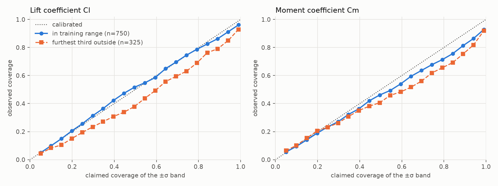

# Results: cst shapes

Generated by `python -m foilnet.analysis.experiments`. Every number comes from one seeded run; the surrounding discussion is in the README.

## Setup

- 5-network deep ensembles. Members differ only in seed (`seed + i`) and use the settings in `configs/train-mlp.toml`: hidden [256, 256], tanh, lr 0.003, 800 epochs.
- Data split: 7000 train / 1500 validation / 1500 test, seed 0. All test numbers below use samples the networks never saw.
- Ensemble prediction is the mean of the members; its uncertainty is the sample standard deviation across members (called spread, or sigma).

## Ensemble on the held-out test set

| target | label spread | single network RMSE (mean) | ensemble RMSE | mean ensemble spread | RMS(error / spread) | Spearman(|error|, spread) |
|---|---|---|---|---|---|---|
| cl | 0.633 | 0.00066 | 0.00048 | 0.000434 | 1.48 | 0.19 |
| cm | 0.065 | 0.000103 | 8.34e-05 | 5.63e-05 | 1.76 | 0.18 |

RMS(error / spread) is 1 for a calibrated ensemble and above 1 when the spread understates the error. Spearman measures whether a larger spread marks the samples that really are worse (1 = perfectly, 0 = not at all).

### How often the error fell inside the claimed band

| target | band | claimed | observed |
|---|---|---|---|
| cl | ±1 spread | 68.3% | 70.6% |
| cl | ±2 spread | 95.4% | 90.9% |
| cl | ±3 spread | 99.7% | 96.7% |
| cm | ±1 spread | 68.3% | 59.0% |
| cm | ±2 spread | 95.4% | 84.9% |
| cm | ±3 spread | 99.7% | 93.1% |

## Solver discretisation error of the labels

RMS difference between the labels (solved with 320 panels) and a 640-panel solve of the first 500 of the 1500 test samples:

| target | RMS difference | as share of label spread |
|---|---|---|
| cl | 0.000474 | 0.07% |
| cm | 0.000114 | 0.18% |

This is the distance from a converged solver, not noise: it is a smooth function of the inputs that a network can learn, and a surrogate trained on these labels inherits it relative to a converged solver.

## Learning curve

| training samples | epochs | cl ensemble RMSE | cl single-net RMSE (±std) | cl mean spread | cm ensemble RMSE | cm single-net RMSE (±std) | cm mean spread |
|---|---|---|---|---|---|---|---|
| 100 | 4000 | 0.0274 | 0.0294 ± 0.00179 | 0.0108 | 0.00452 | 0.00476 ± 0.000225 | 0.00152 |
| 200 | 2000 | 0.0149 | 0.0158 ± 0.000597 | 0.00542 | 0.002 | 0.00213 ± 4.27e-05 | 0.000733 |
| 400 | 1000 | 0.00768 | 0.0083 ± 0.000398 | 0.0032 | 0.000935 | 0.001 ± 6.41e-05 | 0.000379 |
| 800 | 800 | 0.00252 | 0.00301 ± 0.000254 | 0.00167 | 0.000424 | 0.000473 ± 3.16e-05 | 0.000213 |
| 1600 | 800 | 0.00121 | 0.0015 ± 8.78e-05 | 0.000889 | 0.00019 | 0.000218 ± 9.16e-06 | 0.000107 |
| 3500 | 800 | 0.00072 | 0.000915 ± 6.59e-05 | 0.000554 | 0.000115 | 0.00014 ± 3.51e-06 | 7.63e-05 |
| 7000 | 800 | 0.000478 | 0.000666 ± 4.92e-05 | 0.000447 | 8.46e-05 | 0.000105 ± 6.53e-06 | 5.74e-05 |

Epochs are raised for small training sets so that every run gets at least 4000 optimiser steps; otherwise small sets would be under-trained rather than short of data. Epoch selection uses a fixed slice of 100 validation samples whatever the training size.

## Extrapolation: train on thickness < 0.13693, test above it

Trained on 3500 samples. Bands further from the training range are harder.

### cl

| band | samples | RMSE | max |error| | mean spread | RMS(error / spread) | Spearman | inside ±1 spread (68% if calibrated) |
|---|---|---|---|---|---|---|---|
| in range (held out) | 750 | 0.000649 | 0.00618 | 0.000562 | 1.15 | 0.29 | 69% |
| thickness 0.137 to 0.165 | 3160 | 0.00128 | 0.02 | 0.000914 | 1.31 | 0.29 | 68% |
| thickness 0.165 to 0.192 | 1515 | 0.00267 | 0.0228 | 0.00176 | 1.39 | 0.43 | 61% |
| thickness 0.192 to 0.220 | 325 | 0.00486 | 0.0327 | 0.00303 | 1.53 | 0.44 | 59% |

### cm

| band | samples | RMSE | max |error| | mean spread | RMS(error / spread) | Spearman | inside ±1 spread (68% if calibrated) |
|---|---|---|---|---|---|---|---|
| in range (held out) | 750 | 9.86e-05 | 0.000605 | 7.26e-05 | 1.57 | 0.23 | 63% |
| thickness 0.137 to 0.165 | 3160 | 0.000192 | 0.00335 | 0.000114 | 1.66 | 0.26 | 60% |
| thickness 0.165 to 0.192 | 1515 | 0.000339 | 0.00306 | 0.000201 | 1.43 | 0.36 | 59% |
| thickness 0.192 to 0.220 | 325 | 0.000552 | 0.00414 | 0.000306 | 1.62 | 0.36 | 55% |

